The QIUB dosing cap is our proposal for the challenge set by Qiub, a maker of spice grinders and jars, at the 17th Spanish National Packaging Awards (Premios Nacionales de Envase), organised by the Packaging Innovation Cluster (2026). The brief was to solve the dosing of powdered products.

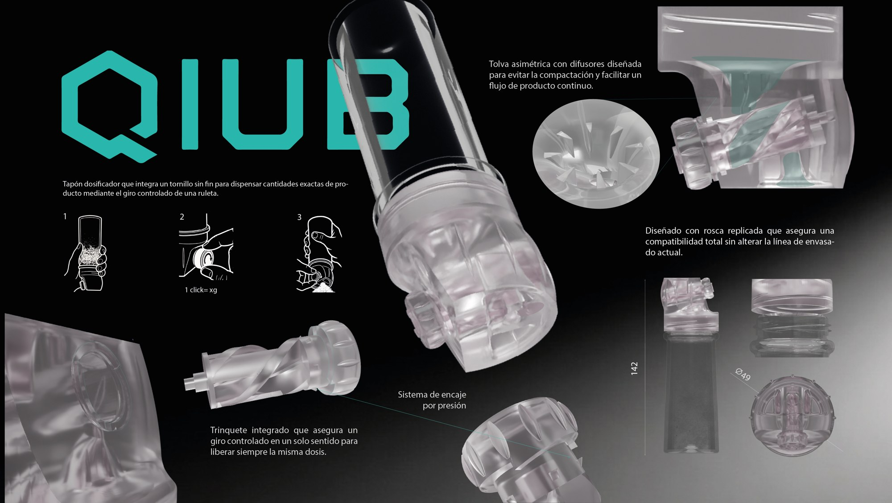
*Competition board.*

## The problem

Adding spices “by eye” is imprecise, steam from the pan gets into the open jar and cakes the powder, and shaker caps force you to shake. So we were after a constant dose every time, a seal against moisture and pouring without shaking, all without touching Qiub's filling line: the cap had to screw onto their existing jars and be made of rPET, like the rest of the pack.

## Ideas and concept

In our sketches we tried gates and gravity valves, but they clogged and took up too much space. A worm screw solved everything in very little room: each turn moves a known volume of powder and, when it stands still, the helix itself blocks any spills.

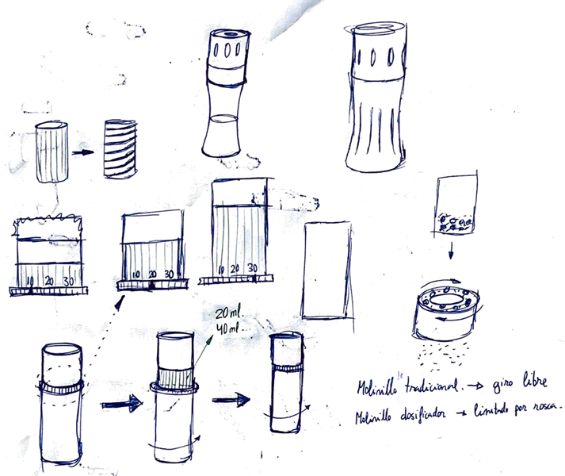
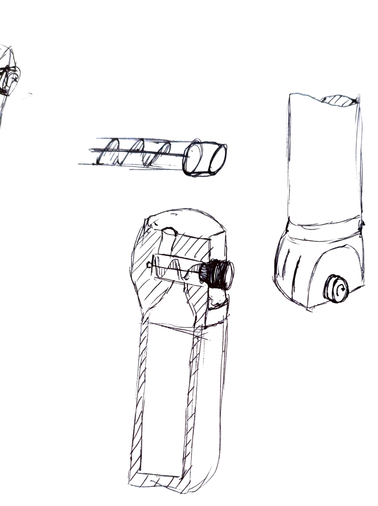
*Early sketches and the move towards a worm screw built into the cap.*

So that the cap would fit Qiub's jars, we reverse-engineered the neck thread from real samples and replicated it in CATIA V5.

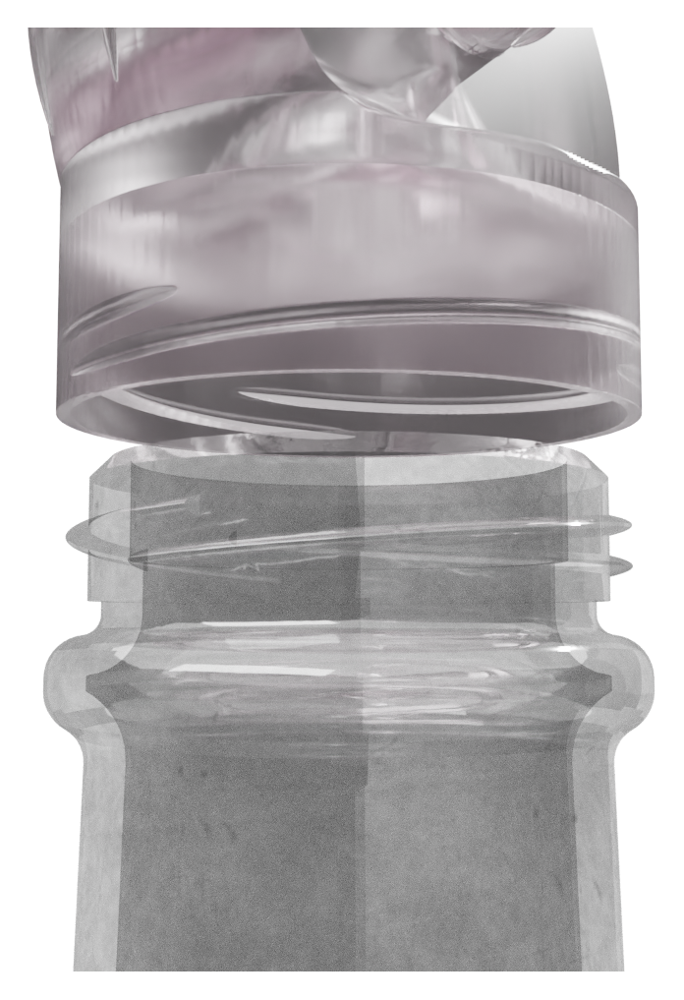
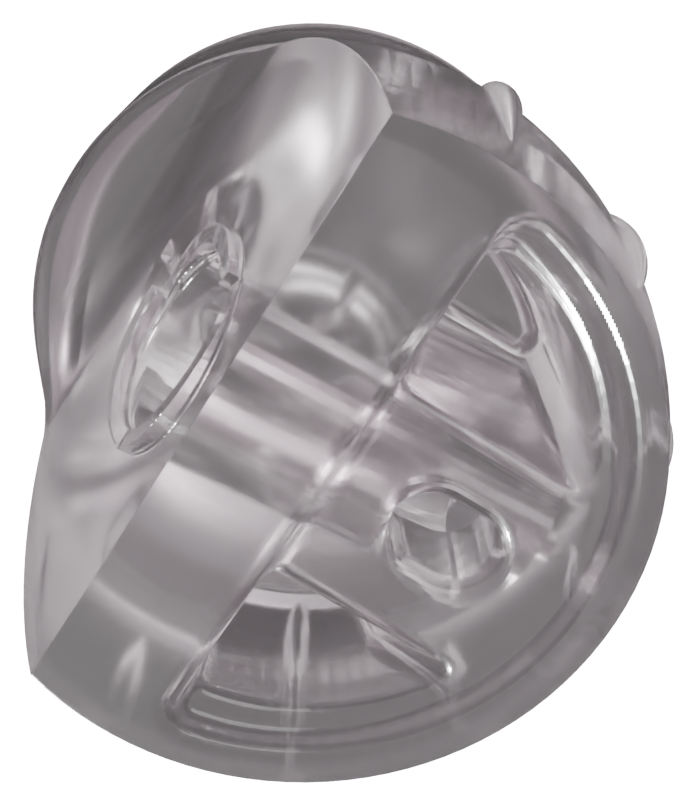
*Thread copied from the commercial jar: the cap screws on without changing anything about the pack.*

## Mechanism

**Screw tilted at 30°.** At rest, the tilt keeps the outlet away from the product and the cap sealed. In use, a slight turn of the wrist brings the outlet to vertical, with no forced pronation and a clear view of where the powder falls.

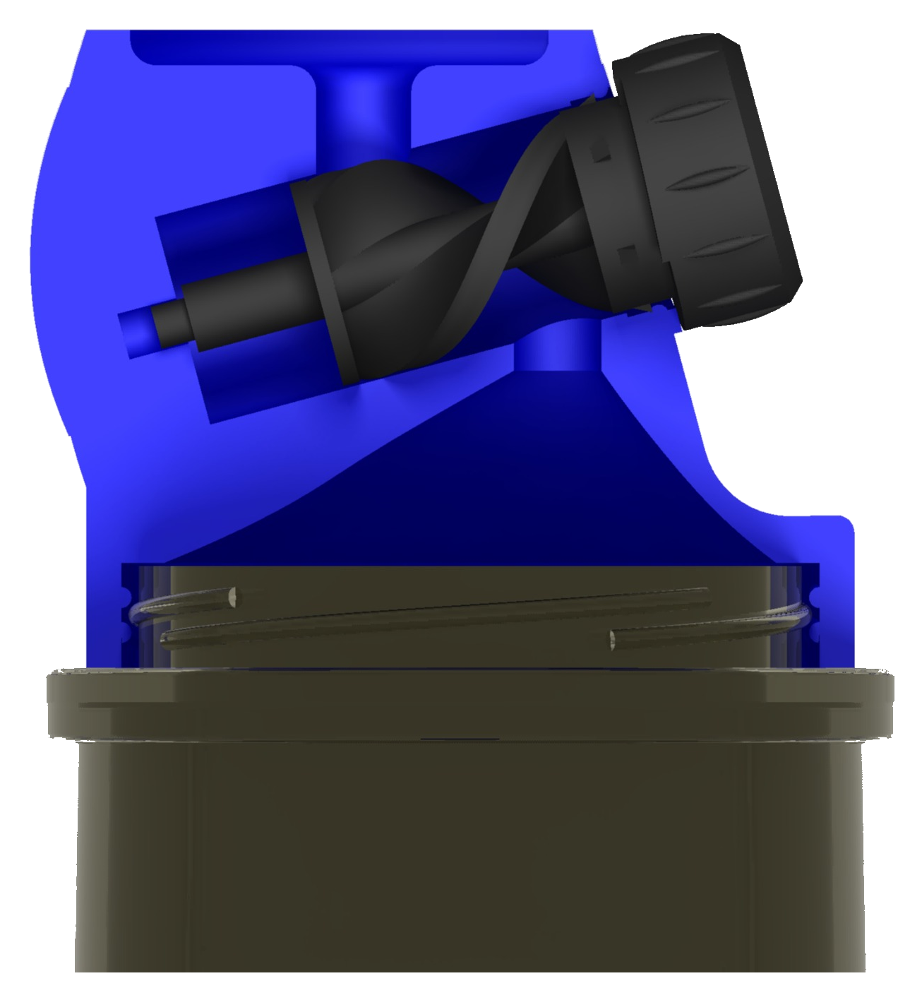
*Section of the assembly, with the cap in blue and the screw tilted at 30°.*

**Snap fit.** The screw is fitted with no fasteners: a pivot at the tip of the shaft snaps into a blind hole in the cap. Thanks to the tolerances and the elastic deformation of the plastic, it is held lengthwise but turns freely.

**Spring-free ratchet.** Facing ridges on the screw and on the outer face of the cap limit rotation to 120° steps, that is, one dose per “click”, in one direction only. The material's own elasticity snaps it back to the locked position, using the small axial play of the snap fit.

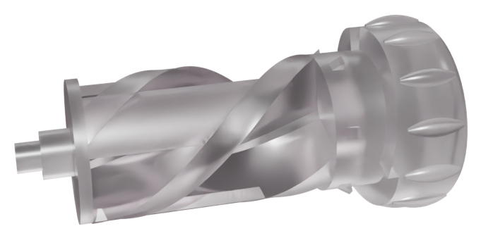
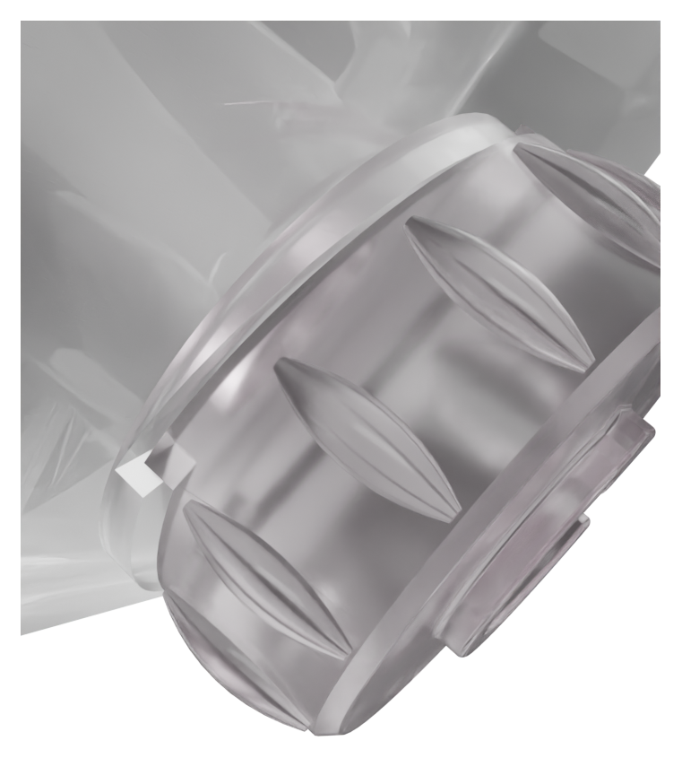
*Worm screw with its dial and a close-up of the ratchet: rotation advances in 120° steps.*

## Sealing

Testing showed that, when the jar was shaken, the powder overcame the slope of the helix and escaped. We solved it by adding **sealing walls** on the outside of the screw: powder passes through the inside, but the walls cover the outlet. The helix is also timed with the ratchet so that, at every resting position, one of those walls sits right in front of the hole, so the cap closes itself as soon as you stop turning.

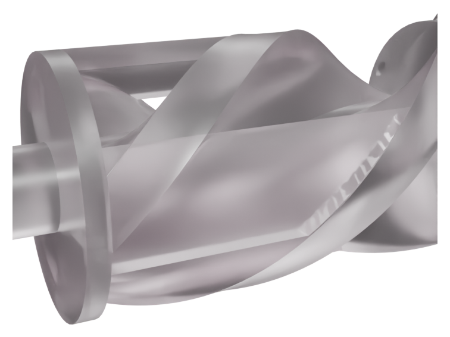
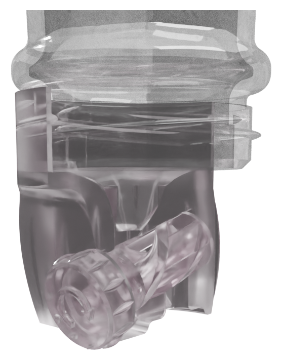
*Sealing walls around the screw, and the screw fitted in the cap.*

## Powder flow

With a symmetrical funnel we got **arching** (the “vault effect”): the powder formed a stable arch over the opening, the channel emptied and the screw turned with nothing in it. First we moved the opening off-centre so the walls had different slopes and the arch broke by shear; then we added **three tooth-shaped diffusers** at the inlet, which stop the arch from finding support and spread the powder evenly between the flights of the helix.

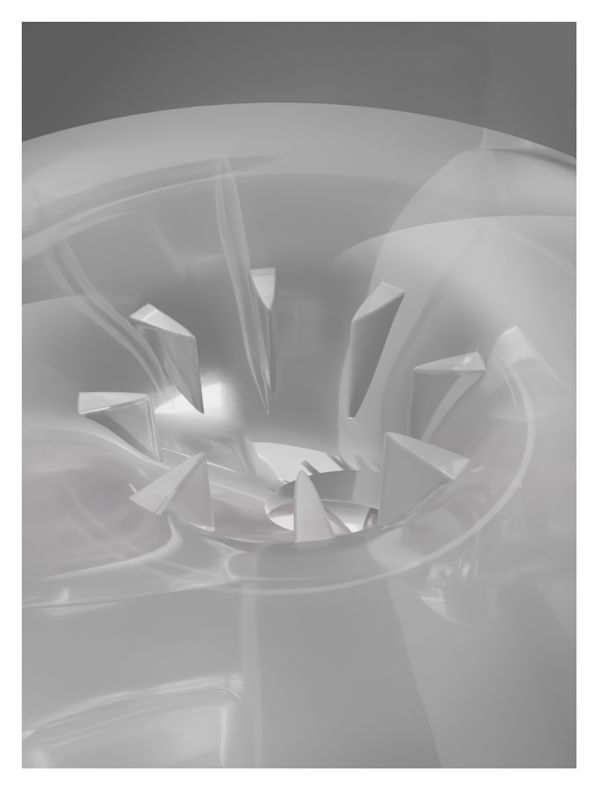
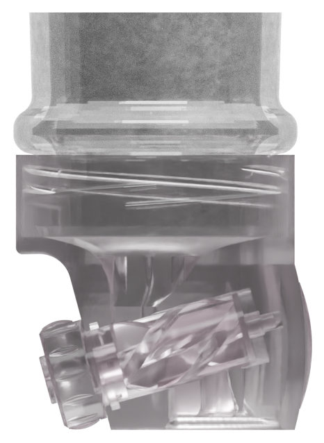
*Asymmetric hopper with diffusers and a section of the assembled cap.*

## Dose calculation

With a helix outer diameter of 12 mm, a 4 mm shaft and a 40 mm pitch:

- Useful cross-section: A = π/4 · (12² − 4²) = 32π ≈ 100.5 mm²
- Volume per turn: A · pitch = 1,280π ≈ 4,021 mm³
- Volume per click (120°): 4,021 / 3 ≈ 1,340 mm³
- Actual volume, with an 85% fill factor: ≈ 1,139 mm³ ≈ **1.14 ml per click**

Multiplying by each spice's bulk density gives the mass per click, which we checked by weighing:

| Spice | Approx. density | Grams per click | Typical dose | Clicks |
| --- | --- | --- | --- | --- |
| Ground turmeric | 0.55 g/ml | 0.63 g | 1.5–2 g | 3 |
| Ground black pepper | 0.55 g/ml | 0.63 g | 1 g | 2 |
| Smoked paprika | 0.50 g/ml | 0.57 g | 2 g | 4 |
| Ground cinnamon | 0.50 g/ml | 0.57 g | 2 g | 4 |
| Ground cumin | 0.50 g/ml | 0.57 g | 2 g | 4 |
| Ground nutmeg | 0.49–0.50 g/ml | 0.56–0.57 g | 1 g | 2 |
| Ground cardamom | 0.48 g/ml | 0.55 g | 1 g | 2 |
| Pure cocoa powder | 0.48 g/ml | 0.55 g | 5 g | 10 |
| Ground cayenne or chilli | 0.45 g/ml | 0.51 g | 1 g | 2 |

*Densities are approximate. Free-flowing powders fill above 85% and cohesive ones below.*

## Prototypes

We 3D-printed several versions to tune the funnel and calibrate the outlet until we found the balance between smooth dispensing and secure retention at rest. The final prototype, in PETG, combines the toothed asymmetric hopper, the optimised pitch and the sealing system, and worked with real spices.

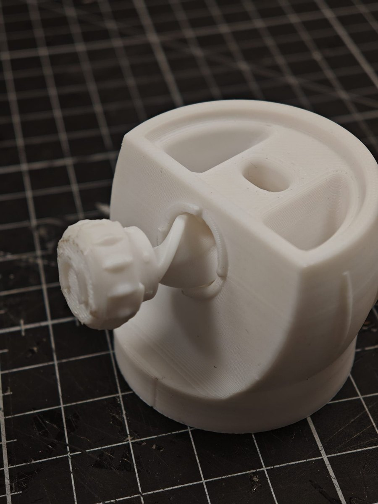
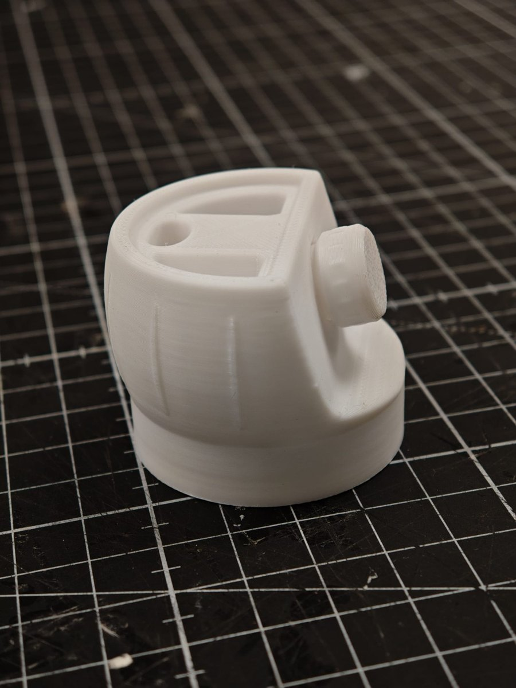
*Prototype iterations.*

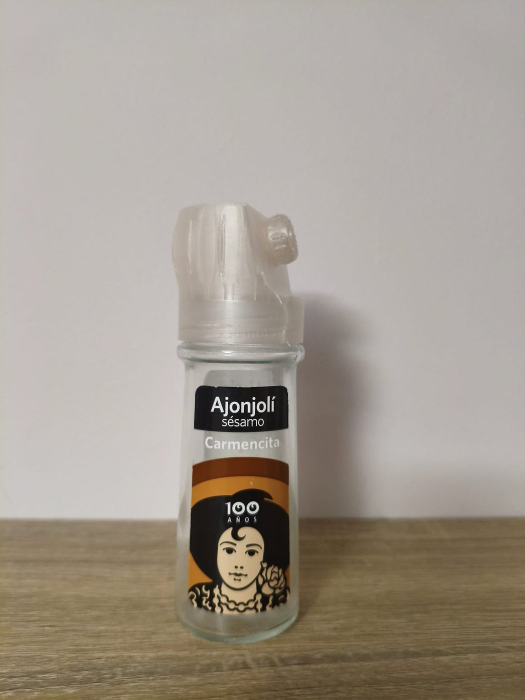
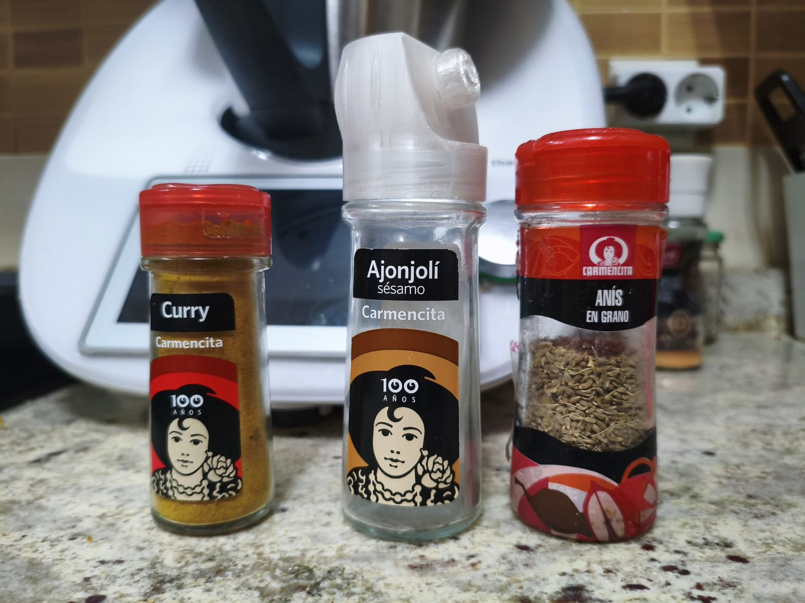
*Final PETG prototype and comparison with the jars in the range: its height and volume match the grinder format.*

## Industrialisation

The cap is designed for injection moulding in rPET, the material Qiub already uses and whose moulding parameters it knows well. The critical tolerances are in the clearance between the screw and its housing: wide enough to turn without seizing and tight enough to keep fine powder in, with cylindricity control on the housing and concentricity control on the shaft. The fit between cap and jar is the one Qiub already uses.

*Assembly drawing: 142 mm overall height and Ø 47.49 mm at the cap. General tolerance ±0.10 mm.*

## Submission board

<a class="boton boton--lleno" href="/proyectos/dosificador-qiub/QIUB-panel.pdf" download>Download the board (PDF, 6 MB)</a>
