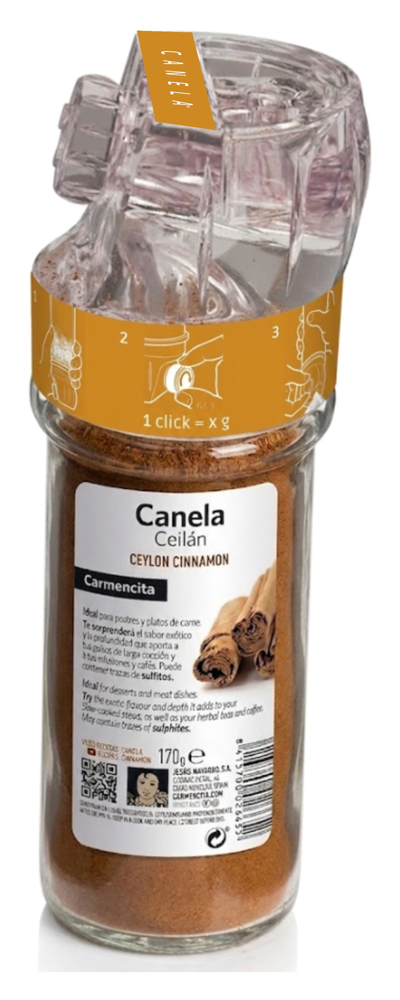

El dosificador QIUB es nuestra propuesta para el reto que planteó Qiub, fabricante de molinillos y envases para especias, en los XVII Premios Nacionales de Envase que organiza el Clúster de Innovación en Envase y Embalaje (2026). El reto pedía resolver la dosificación de productos en polvo. Lo desarrollamos entre cuatro estudiantes de 3.º de Ingeniería en Diseño Industrial de la Universidad de Valladolid y lo entregamos con un dosier técnico y un panel. No llegó a la final.

*Panel de entrega del concurso.*

## El problema

Echar especias «a ojo» es impreciso y difícil de repetir: es fácil pasarse con una especia picante. Además, el bote se abre encima de la olla, el vapor entra, el polvo se apelmaza y pierde aroma; y los tapones perforados obligan a sacudir el bote, de modo que el polvo cae de golpe y no se corta en cuanto dejas de usarlo.

Nos marcamos tres objetivos:

- **Dosis constante y repetible** en cada uso, en lugar del vertido aleatorio.
- **Estanqueidad** en reposo y durante el uso, como barrera frente al vapor.
- **Vertido sin sacudir**: que la fuerza para sacar el producto no dependa de agitar el bote y que el flujo se corte al instante.

Y una restricción de partida: no tocar la línea de envasado de Qiub. El tapón debía roscar en sus botes actuales, con sus tamaños y etiquetas, y fabricarse en el mismo material, rPET, para que el envase siguiera siendo monomaterial y fácil de reciclar.

## Ideas y concepto

En los bocetos probamos compuertas y válvulas por gravedad, pero se atascaban y ocupaban demasiado. El tornillo sin fin lo resolvía todo en muy poco espacio: cada giro mueve un volumen conocido de polvo y, cuando está quieto, la propia hélice hace de barrera contra los derrames.

*Primeros bocetos y evolución hacia el tornillo sin fin integrado en el tapón.*

Para que el tapón encajara en los botes de Qiub, hicimos ingeniería inversa de la rosca del cuello a partir de muestras reales y la replicamos en CATIA V5.

*Rosca replicada del bote comercial: el tapón se enrosca sin cambiar nada del envase.*

## Mecanismo

**Tornillo inclinado 30°.** En reposo, la inclinación aleja la salida del producto y mantiene el cierre. Al usarlo, basta girar un poco la muñeca para que la salida quede vertical, sin forzar la pronación y dejando ver dónde cae el polvo.

*Sección del conjunto, con la tapa en azul y el tornillo inclinado 30°.*

**Encaje a presión.** El tornillo se monta sin piezas de fijación: un pivote en la punta del eje entra a presión en un taladro ciego de la tapa. Con las tolerancias y la deformación elástica del plástico, queda retenido a lo largo pero gira libremente.

**Trinquete sin muelles.** Unos resaltes enfrentados en el tornillo y en la cara exterior de la tapa limitan el giro a pasos de 120°, es decir, a una dosis por «clic», y solo en un sentido. El retorno a la posición de bloqueo lo da la elasticidad del propio material, aprovechando el pequeño juego axial del encaje a presión.

*Tornillo sin fin con la ruleta y detalle del trinquete: el giro avanza de 120° en 120°.*

## Estanqueidad

En los ensayos vimos que, si se sacudía el bote, el polvo vencía la pendiente de la hélice y se escapaba. Lo resolvimos añadiendo unas **paredes de obturación** en el exterior del tornillo: dejan pasar el polvo por dentro, pero tapan el orificio de salida. Además, la hélice está sincronizada con el trinquete para que, en cada posición de reposo, una de esas paredes quede justo delante del agujero, así que el dosificador se cierra solo en cuanto dejas de girar.

*Paredes de obturación en la periferia del tornillo y tornillo montado en la tapa.*

## Flujo del polvo

Con un embudo simétrico aparecía el **efecto bóveda**: el polvo formaba un arco estable sobre la abertura, el conducto se vaciaba y el tornillo giraba en vacío. Primero descentramos el orificio para que las paredes tuvieran pendientes distintas y el arco se rompiera por cizalladura; después añadimos **tres difusores en forma de diente** en la entrada, que impiden que el arco se apoye y reparten el polvo de forma homogénea entre los huecos de la hélice.

*Tolva asimétrica con difusores y sección del conjunto montado.*

## Cálculo de la dosis

Con un diámetro exterior de la hélice de 12 mm, un eje de 4 mm y un paso de 40 mm:

- Sección útil: A = π/4 · (12² − 4²) = 32π ≈ 100,5 mm²
- Volumen por vuelta: A · paso = 1.280π ≈ 4.021 mm³
- Volumen por clic (120°): 4.021 / 3 ≈ 1.340 mm³
- Volumen real, con un coeficiente de llenado del 85 %: ≈ 1.139 mm³ ≈ **1,14 ml por clic**

Multiplicando por la densidad aparente de cada especia sale la masa por clic, que comprobamos pesando:

| Especia | Densidad aprox. | Gramos por clic | Dosis habitual | Clics |
| --- | --- | --- | --- | --- |
| Cúrcuma molida | 0,55 g/ml | 0,63 g | 1,5–2 g | 3 |
| Pimienta negra molida | 0,55 g/ml | 0,63 g | 1 g | 2 |
| Pimentón ahumado | 0,50 g/ml | 0,57 g | 2 g | 4 |
| Canela molida | 0,50 g/ml | 0,57 g | 2 g | 4 |
| Comino molido | 0,50 g/ml | 0,57 g | 2 g | 4 |
| Nuez moscada molida | 0,49–0,50 g/ml | 0,56–0,57 g | 1 g | 2 |
| Cardamomo molido | 0,48 g/ml | 0,55 g | 1 g | 2 |
| Cacao puro en polvo | 0,48 g/ml | 0,55 g | 5 g | 10 |
| Cayena o chile molido | 0,45 g/ml | 0,51 g | 1 g | 2 |

*Las densidades son aproximadas. Los polvos que fluyen bien llenan más que el 85 % y los cohesivos, menos.*

## Prototipos

Imprimimos varias versiones en 3D para ajustar el embudo y calibrar el orificio de salida hasta encontrar el equilibrio entre un dispensado fluido y una retención segura en reposo. El prototipo final, en PET-G, integra la tolva asimétrica con dientes, el paso optimizado y el sistema de cierre, y funcionó con especias reales.

*Iteraciones del prototipo.*

*Prototipo final en PET-G y comparación con los botes de la gama: la altura y el volumen encajan con el formato de molinillo.*

## Etiquetas

Repartimos la información en tres etiquetas: la del producto, que se queda como la usa el fabricante; una de **instrucciones**, con tres viñetas, en la franja que cubre la rosca; y una pequeña de **identificación** en la parte superior, para reconocer la especia desde arriba cuando los botes están en un cajón. Para que cupiera tuvimos que ensanchar un elemento superior de la tapa.

*Etiquetas de instrucciones (sobre la rosca) y de identificación (arriba).*

## Industrialización

El tapón está pensado para moldeo por inyección en rPET, el material que Qiub ya usa y cuyos parámetros de inyección domina. Las tolerancias críticas están en la holgura entre el tornillo y su alojamiento, lo bastante amplia para que gire sin agarrotarse y lo bastante cerrada para que no se escape el polvo fino, con control de cilindricidad en la carcasa y de concentricidad en el eje. El ajuste entre tapa y bote es el que Qiub ya utiliza.

*Plano del conjunto: 142 mm de altura total y Ø 47,49 mm en la tapa. Tolerancia general ±0,10 mm.*
