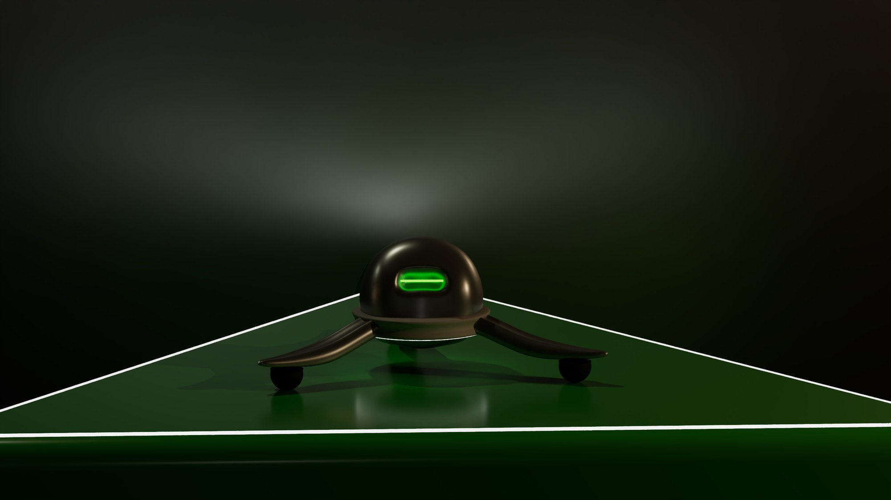
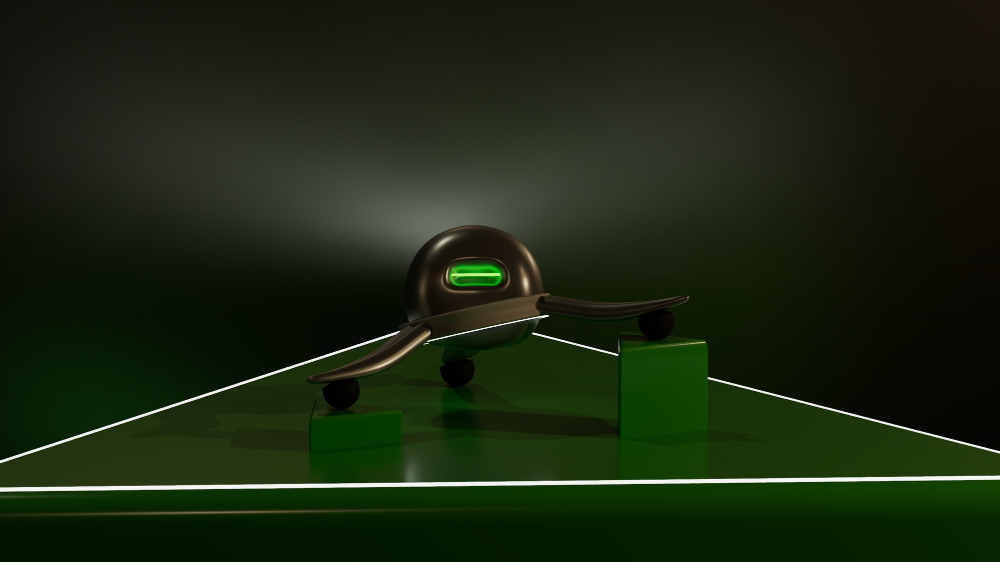
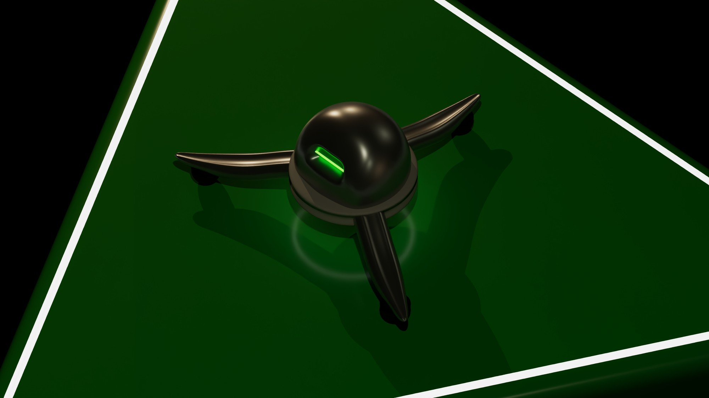
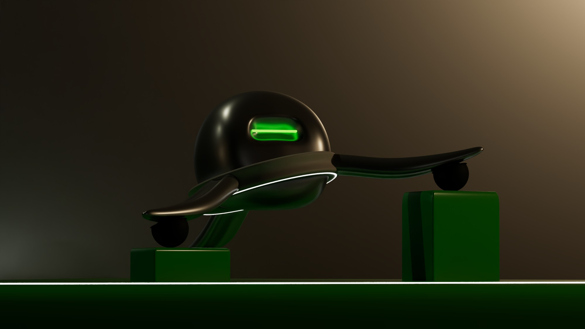
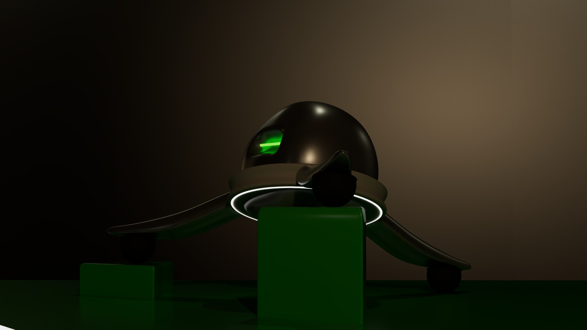
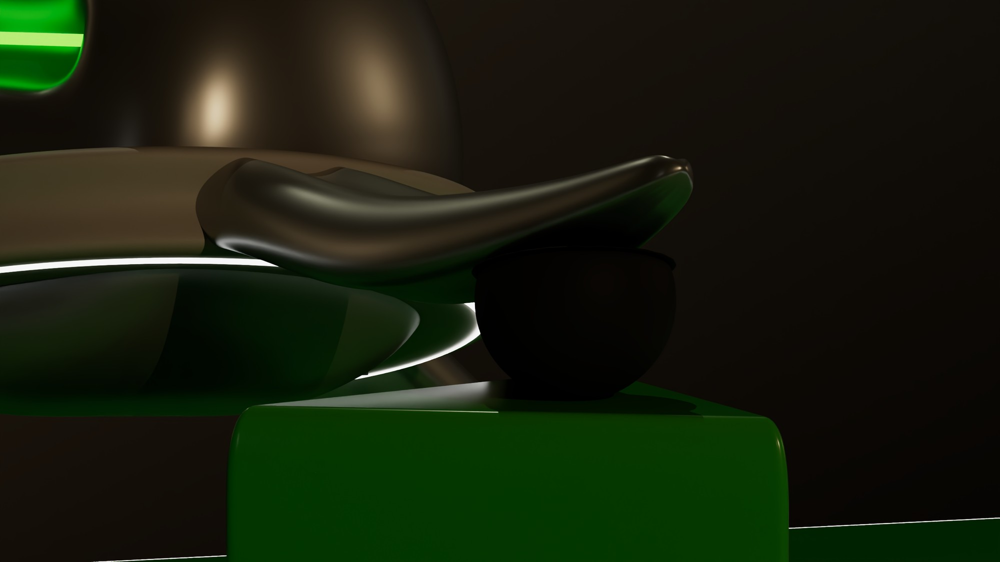
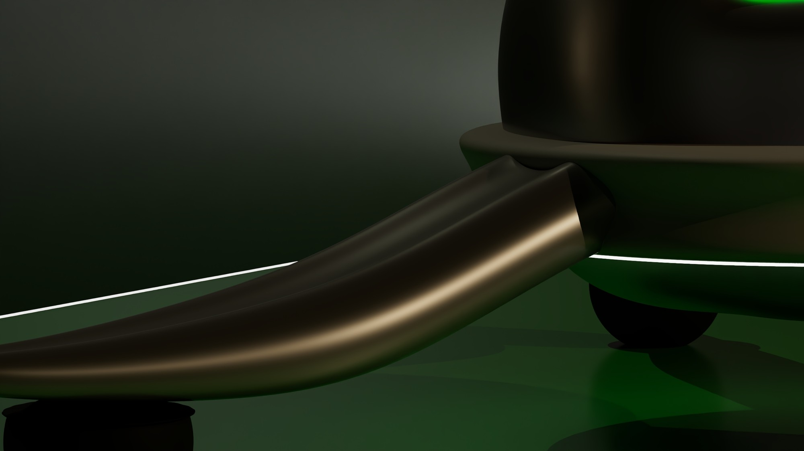
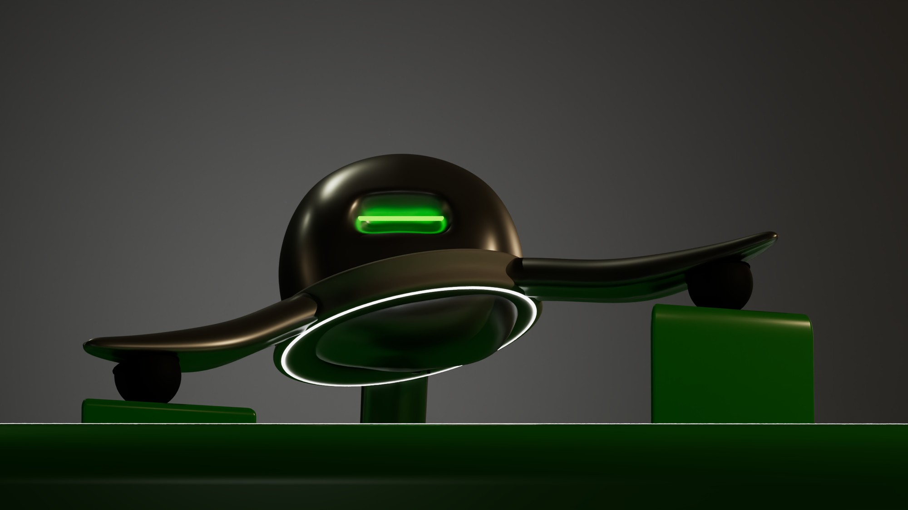

Kuris es un dron terrestre pensado para moverse por cualquier terreno. En lugar de hélices, se apoya en tres brazos curvados que terminan en ruedas esféricas, así que puede avanzar en cualquier dirección y salvar desniveles sin perder el equilibrio, y todo el carácter del producto se concentra en una cabeza en cúpula con un único ojo de luz verde.

En el visor 3D de arriba puedes girar el dron, acercarte a los brazos y a las ruedas, cambiar el acabado (bronce, blanco o arena) y apagar o encender la luz del ojo y del anillo. En la vista «En marcha», Kuris recorre en bucle un circuito con dos bordillos: el anillo, con los tres brazos fijos, gira para buscar apoyo y se inclina para que las tres ruedas toquen siempre el suelo, mientras la cabeza va nivelada.

## La idea

Quería que Kuris se leyera como un vehículo robusto y, a la vez, como un pequeño personaje, ya que es lo que hace que un producto así se recuerde. Por eso la forma es muy sencilla (una cúpula, un disco y tres brazos) y la expresión la pone el ojo: una ranura alargada con luz verde que funciona como mirada y como indicador de estado.

*Vista frontal: la cúpula, el ojo de luz verde y los brazos abiertos hacia las ruedas.*

## La forma

El cuerpo es una cúpula que descansa sobre un disco rodeado por un anillo de luz blanca, que marca el contorno del dron cuando hay poca luz. De ese disco salen tres brazos repartidos a 120°, que se curvan hacia abajo y se estrechan hasta la rueda, como si fueran patas. Al estar a tres puntos, el dron siempre apoya en las tres ruedas, aunque el suelo no sea plano, y las ruedas esféricas de goma le permiten girar sobre sí mismo.

*Apoyado en dos bloques de distinta altura y visto en planta, con los tres brazos a 120°.*

*Frontal de cerca y vista trasera, con el anillo de luz bajo el disco.*

## Acabado y renders

*Detalles del brazo: arranque desde el disco y curva hacia la rueda.*

*Render de estudio de la versión final.*
