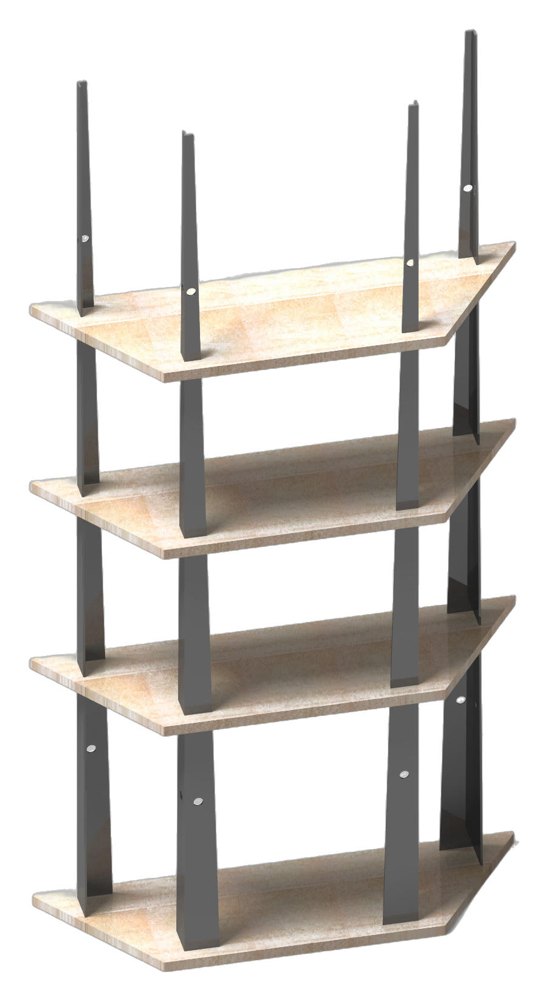
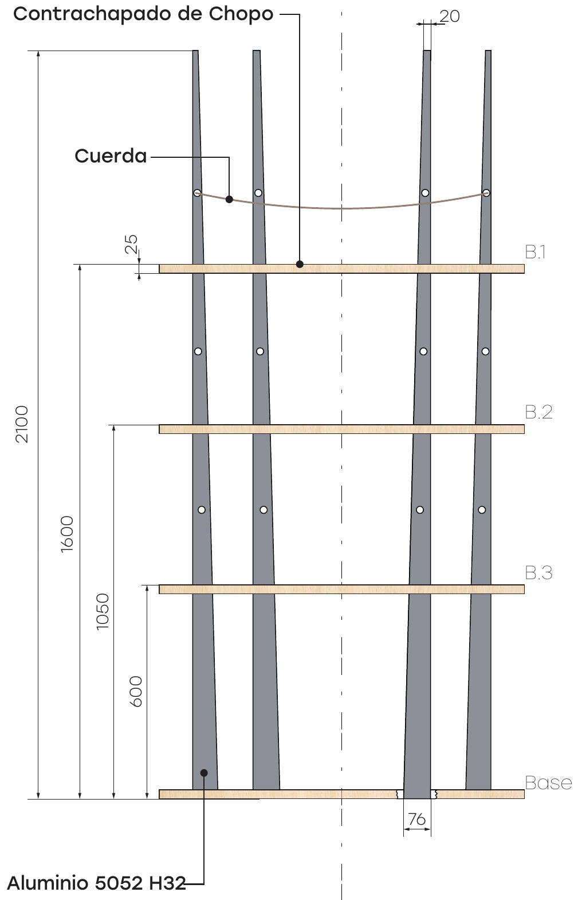
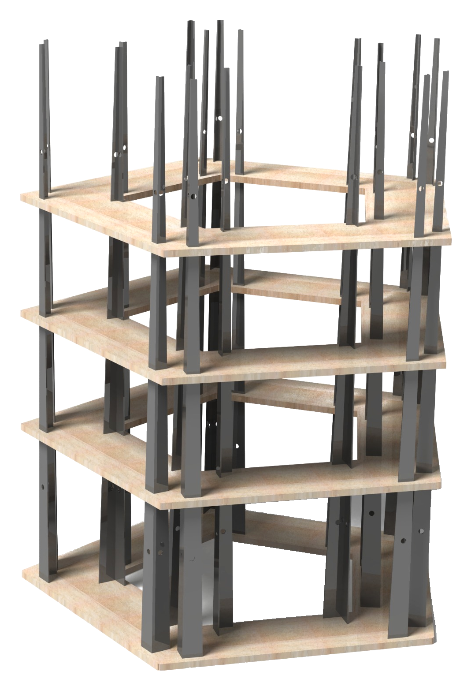
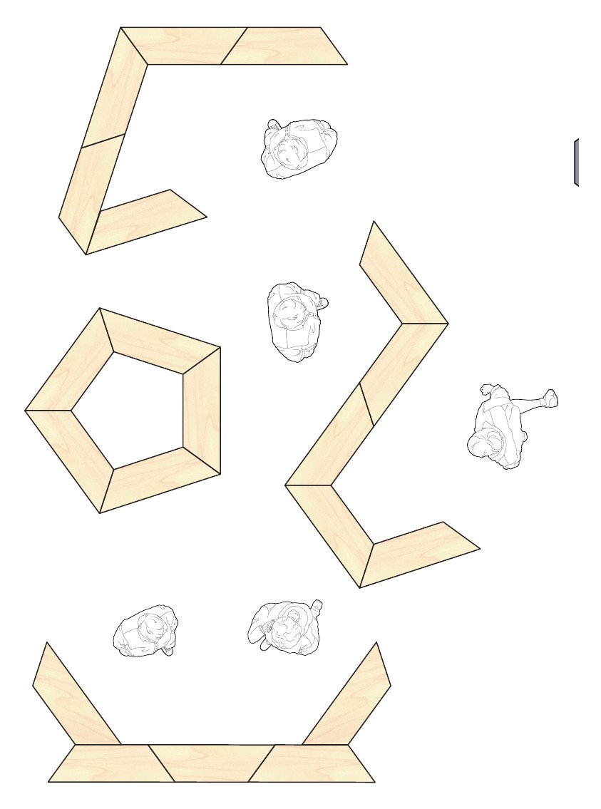
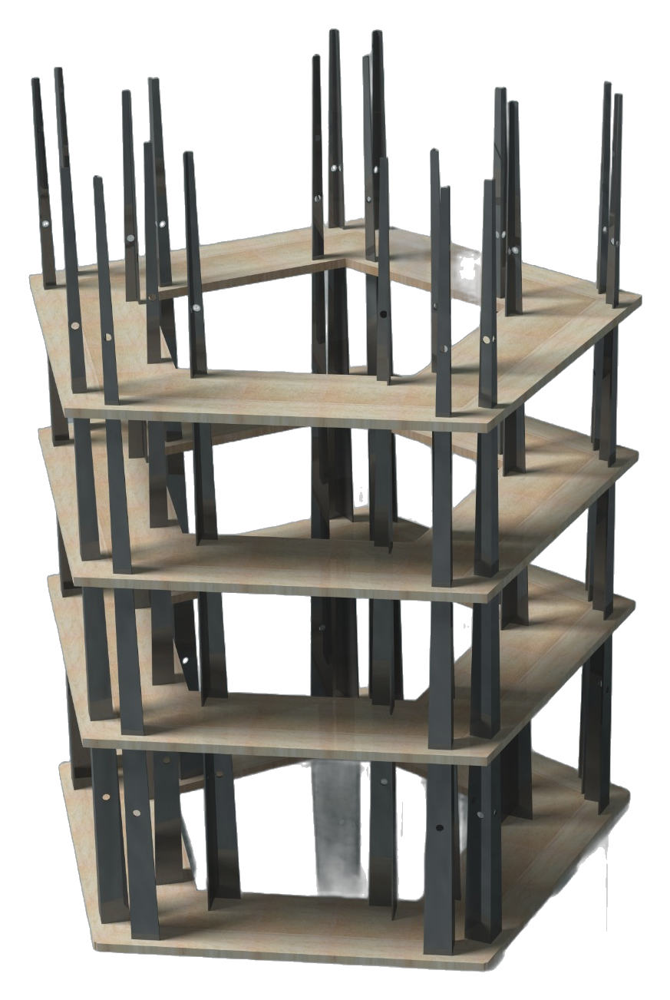
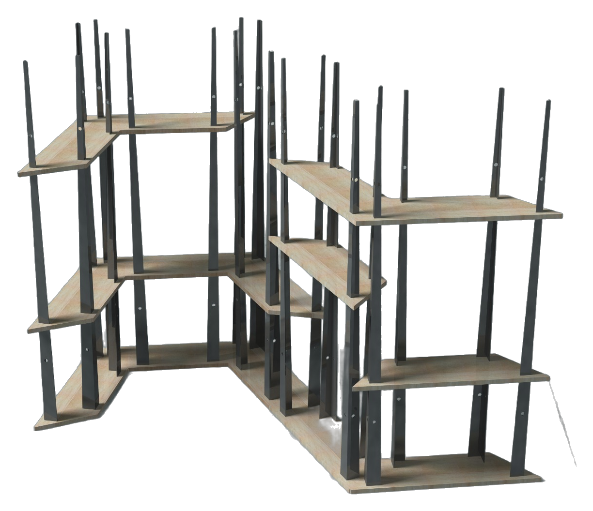
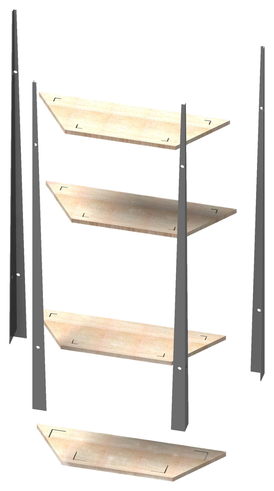
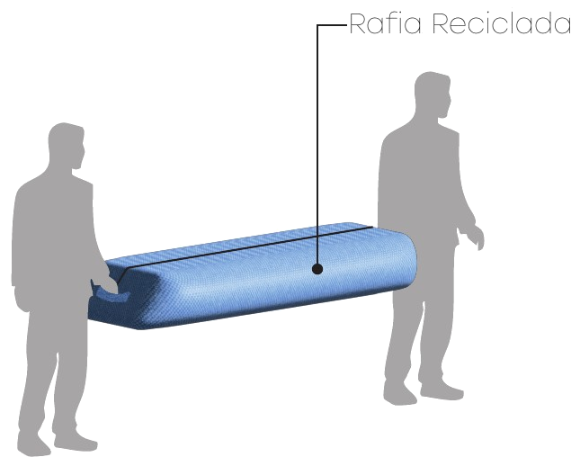

MIES is a project for the “Proyecto de Cátedra” competition launched in December 2025 by AEICE, the Efficient Habitat Cluster of Castilla y León, and the Valladolid School of Architecture (ETSAVA). The brief asked for a modular, demountable and transportable display system for exhibiting work by University of Valladolid students, and the submission, on 26 January 2026, was an A1 board and a manufacturing budget.

## Concept

> Mies (Spanish). Ripe cereal ready to be harvested, the basis of the Castilian landscape.

The project starts from an inversion: the fragility of the ears of grain becomes aluminium beams grouped together like a field of cereal. The name also plays with a second meaning: an architecture of material and structural clarity, where “less is more”. The proposal combines a forestry resource from Castilla y León, poplar plywood, with the industrial precision of aluminium.

## Design and CAD

Each module has a base and three trapezoidal poplar plywood shelves, plus four L-shaped aluminium profiles 2.1 m tall that taper from 76 to 20 mm. That is why each shelf has slots of a different size (60, 49 and 37 mm) and locks at its own height with no fittings: once slotted in, the shelves themselves form the structure.

*Assembled module and dimensioned elevation: 2,100 mm tall, with shelves at 600, 1,050 and 1,600 mm.*

The sides of the trapezoid are at 36° from vertical, so five modules close into a pentagon. The model and the CNC cutting drawings were made in CATIA V5.

## Groupings

Arranged in a circle, the modules create open meeting areas for face-to-face conversation; in a zigzag, the structure stretches along circulation areas; and open layouts form small shelters that gently divide the space. Holes in the profiles allow ropes to be tensioned to hang A1 panels.

*Pentagon grouping and plan diagrams of the different layouts.*

*Another view of the pentagon and an open grouping.*

<figure class="visor-md">
<model-viewer src="/modelos/mies-pentagono.glb" alt="Five MIES modules closing into a pentagon, in 3D" camera-controls touch-action="pan-y" auto-rotate auto-rotate-delay="1500" rotation-per-second="14deg" interaction-prompt="none" camera-orbit="112deg 68deg auto" shadow-intensity="0.85" shadow-softness="0.75" exposure="1" tone-mapping="neutral" environment-image="/modelos/estudio.hdr" ar ar-modes="webxr scene-viewer quick-look"><button slot="ar-button" class="boton visor-md__ar">View in your space (AR)</button></model-viewer>
<figcaption>Pentagon grouping in 3D, set up as in an exhibition: a different shelf in each module holding scale models, A1 sheets hanging at the back from cords threaded through the holes in the profiles, and a 1.75 m figure for scale. Drag to rotate it or, on your phone, place it in your space with the augmented reality button.</figcaption>
</figure>

## Assembly and transport

The base goes down first for stability, then the profiles slot in to form the frame and, with the frame standing, the shelves are placed from the bottom up.

*Exploded view: base, three shelves and four aluminium profiles.*

Each module travels in a recycled agricultural raffia bag, true to the origin of the material, with handles for two people to carry, so installation is a shared effort from the start.

*Packaging in a recycled raffia bag.*

## Materials and budget

25 mm poplar plywood, linked to the forestry industry of Castilla y León, and 5 mm 5052 H32 aluminium sheet, cut and folded. Along with the board we submitted a manufacturing budget:

| Budget (VAT included, with income tax withholding) | Total |
| --- | --- |
| Prototype, 1 module | €1,015.48 |
| Set of 5 modules | €2,385.00 |
| Run of 10 modules (estimate) | about €4,000 |

*Indicative figures, calculated in January 2026, when the design was made.*

In series production the cost per module drops from €1,015 to about €400, thanks to bulk purchasing, CNC nesting of the boards and spreading the fixed costs of programming and transport.

## Competition board

<a class="boton boton--lleno" href="/proyectos/mies/MIES-lamina-A1.pdf" download>Download the A1 board (PDF, 1.5 MB)</a>
