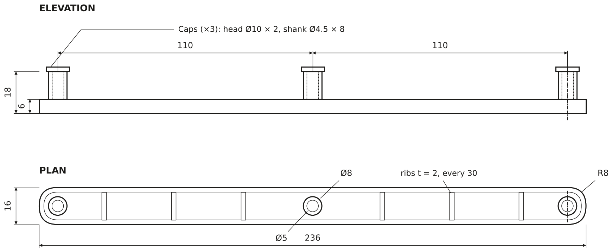
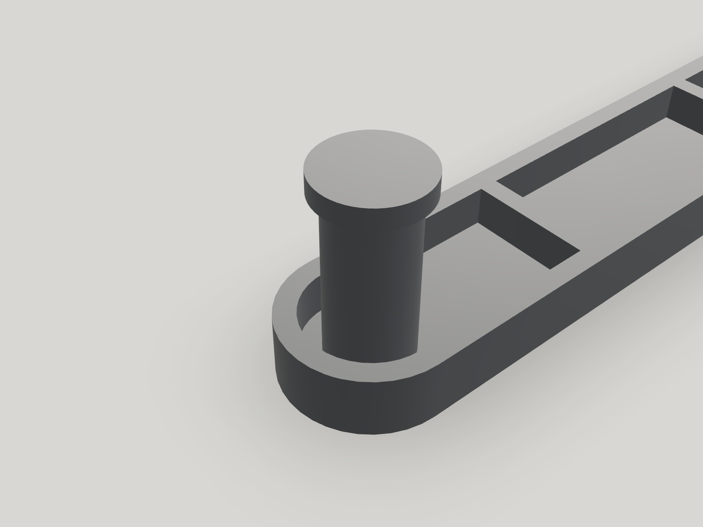
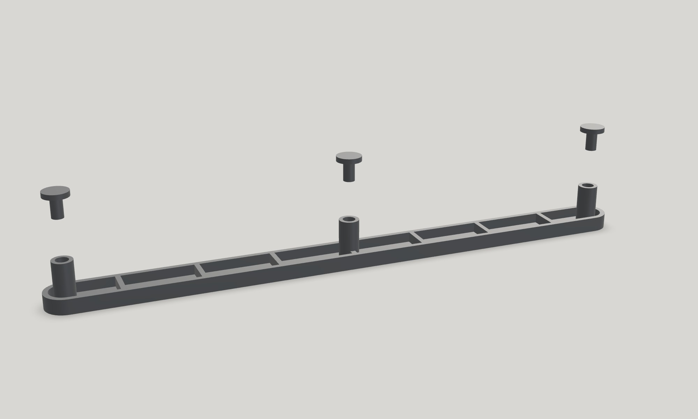

A drawer in a drawer unit had some brackets that broke, so I was asked to make new ones. Instead of copying the part as it was, I measured it, remodelled it, optimising wall thicknesses and sizes so it would be sturdier than the original, and made it with 3D printing.

## The problem

The original brackets had broken, so the drawer was no longer held properly. Fixing it without replacing the furniture meant making a new part that fitted exactly like the original and was also stronger.

## Measuring

I measured the broken part with a calliper, and also the housing it sits in, since the new part had to fit that space without play. I then kept comparing the model with the broken part to check that the dimensions matched.

*Main dimensions of the bracket (mm).*

## Redesign in SolidWorks

With those measurements, I modelled the part in SolidWorks as a 236 × 16 × 6 mm bar with rounded ends (R8), shaped as a channel with 2 mm walls and 2 mm cross ribs every 30 mm, for stiffness without extra material. It carries three hollow Ø8 mm bosses, 110 mm apart. Compared with the original, I adjusted wall thicknesses and sizes to make it sturdier.

*A cap fitted on its boss and the exploded view with the three caps out.*

I also added caps (Ø10 × 2 mm head and Ø4.5 × 8 mm shank), one on each boss. They work as stoppers so the part cannot slide out on that side, adding extra security to the glue. The “Exploded” view in the 3D viewer above shows how they fit.

## Manufacturing

I printed the bar and the caps in PLA on a Bambu Lab printer. As it is a small part with a simple geometry, 3D printing made it quick to produce and easy to reprint if any dimension needed changing.

## Result

The result was as expected: the new brackets fit the housing in the furniture and hold the drawer well.
