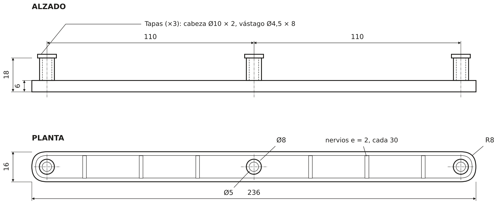

Un cajón de una cajonera tenía unos soportes que se partieron, así que me encargaron hacer unos nuevos. En lugar de copiar la pieza tal cual, la medí, la volví a modelar optimizando espesores y tamaños para que fuera más robusta que la original y la fabriqué con impresión 3D.

## El problema

Los soportes originales se habían partido, por lo que el cajón ya no quedaba bien sujeto. Para arreglarlo sin cambiar el mueble había que hacer una pieza nueva que encajara igual que la original y que, además, aguantara mejor.

## Medición

Tomé las medidas con el calibre sobre la pieza rota y también las del hueco donde va montada en el mueble, ya que la pieza nueva tenía que entrar sin holgura en ese espacio. Después fui comparando el modelo con la pieza rota para comprobar que las medidas coincidían.

*Cotas principales del soporte (mm).*

## Rediseño en SolidWorks

Con las medidas, modelé la pieza en SolidWorks como una barra de 236 × 16 × 6 mm con los extremos redondeados (R8), en forma de canal con paredes de 2 mm y nervios transversales de 2 mm cada 30 mm, para ganar rigidez sin añadir material de más. Sobre ella van tres tetones huecos de Ø8 mm separados 110 mm entre sí. Respecto a la original, ajusté los espesores y los tamaños para que fuera más robusta.

*Una tapa colocada en su tetón y el despiece con las tres tapas fuera.*

Además, añadí unas tapas (cabeza de Ø10 × 2 mm y vástago de Ø4,5 × 8 mm), una en cada tetón. Hacen de tapón para que la pieza no se salga por ese lado, así que dan una seguridad añadida al pegamento. En el visor 3D de arriba, la vista «Despiece» enseña cómo encajan.

## Fabricación

Imprimí la barra y las tapas en PLA con una impresora Bambu Lab. Al ser una pieza pequeña y con una geometría sencilla, la impresión 3D permitía hacerla en poco tiempo y repetirla si hacía falta cambiar alguna medida.

## Resultado

El resultado fue el esperado: los soportes nuevos encajan en el hueco del mueble y aguantan bien el cajón.
